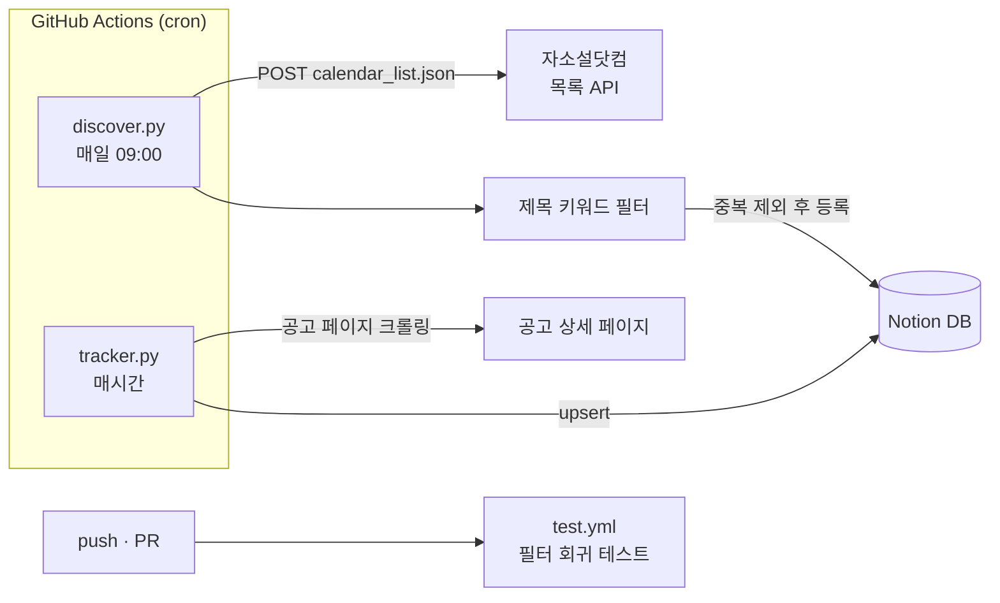

# JobRadar

> 채용공고를 **매일 자동으로 찾아** Notion에 올리고, 관심 공고는 **매시간 마감일·경쟁률을 갱신**하는 추적기

   

<sub>개인 프로젝트 · 설계·구현·운영 1인 · 2026.03 ~ 운영 중 · 대상: 자소설닷컴</sub>

<br/>

## 핵심 성과

| 지표 | 결과 |
|---|---|
| 수집 방식 | 브라우저 자동화 없이 **API 1회 호출로 두 달치 570여 건** |
| 실행 주기 | 발견 **매일 09:00**, 추적 **매시간**, 서버 없이 GitHub Actions로 운영 |
| 필터 개선 | 실제 운영 데이터로 **4차례** 규칙 수정 |
| 회귀 테스트 | 운영 중 나온 오탐 사례 **30건**, push·PR마다 CI 실행 |

<br/>

## 주요 기능

- **공고 발견** — 목록 API에서 관심 직무 공고를 골라 Notion DB에 `발견됨`으로 올리고, 이미 있는 공고는 건너뜁니다.
- **공고 추적** — 등록한 공고의 마감일·작성자 수·직무별 작성자 수를 매시간 갱신하고 `추적중`으로 표시합니다.
- **키워드 필터** — 제외어 → 키워드 순으로 제목만 검사하고, 영문 약어는 단어 경계로 매칭합니다.
- **설정 분리** — Notion 키·DB ID·추적 URL·키워드는 모두 GitHub Secrets로 주입해 코드 수정 없이 바꿉니다.

<br/>

## 아키텍처



<br/>

## 기술 스택

| 영역 | 사용 기술 |
|---|---|
| 수집 | Python, requests, BeautifulSoup, lxml |
| 저장 | Notion API |
| 운영 | GitHub Actions (schedule · workflow_dispatch), GitHub Secrets |
| 품질 | pytest 30건, push·PR CI |

<br/>

## 내 역할

1인 프로젝트로 **문제 정의, 설계, 구현, 운영**을 모두 했습니다. 등록한 URL만 추적하던 [초기 버전](https://github.com/Hun2e/Recruitment-notice-Tracking)에서 시작해, 공고 발견 기능과 필터 회귀 테스트를 더했습니다.

<br/>

## 기술적 의사결정

### 1. 목록 페이지가 크롤링되지 않는다 → 내부 API를 찾아 직접 호출

- **문제**: 공고 목록 페이지가 JavaScript로 렌더링되어 HTML을 받아도 공고가 없었습니다.
- **결정**: 브라우저 자동화를 붙이는 대신, 페이지가 내부적으로 호출하는 목록 API(`calendar_list.json`)를 찾아 그대로 호출했습니다. robots.txt 허용 범위도 확인했습니다.
- **결과**: 한 번 호출로 두 달치 570여 건을 받아, 브라우저 없이 GitHub Actions 러너에서 가볍게 돌아갑니다.

### 2. 직무 정보가 숫자 코드뿐이다 → 제목 키워드 필터를 실제 데이터로 다듬기

- **문제**: API의 직무 필드는 숫자 코드만 주고 이름을 주지 않아, 직무로 거를 수 없었습니다.
- **결정**: 제목 키워드로 거르되, 운영하며 나온 오탐을 보고 규칙을 4차례 고쳤습니다.
  - 회사명은 보지 않고 제목만 검사 (`현대엔지니어링`이 '엔지니어'에 걸리던 문제)
  - 영문 약어는 단어 경계 적용 (`IT`가 `Recruiting`에, `data`가 `Database`에 걸리던 문제)
  - 직무가 안 적힌 공채는 IT 기업일 때만 후보로 올림
  - 교육과정·부트캠프·경력직 제외
- **결과**: 식품·유통·건설 공채나 교육 광고가 섞이지 않는 후보 목록이 매일 올라옵니다.

### 3. 필터를 고치면 예전 오탐이 다시 들어온다 → 운영 사례를 회귀 테스트로 고정

- **문제**: 규칙 하나를 고치면 이전에 막아 둔 오탐이 다시 통과하는 일이 생겼습니다.
- **결정**: 운영 중 실제로 나온 사례 30건(`KT&G`, `드림라인`, `CAMPUS` 등)을 테스트로 고정하고, push·PR마다 GitHub Actions에서 돌립니다.
- **결과**: 필터를 바꿀 때 기존 동작이 깨지면 바로 CI에서 드러납니다.

<br/>

## 실행 방법

```bash
python3.11 -m venv .venv && .venv/bin/pip install requests beautifulsoup4 lxml pytest
.venv/bin/python -m pytest -q tests        # 필터 테스트
```

운영하려면 저장소 Secrets에 `NOTION_API_KEY`, `NOTION_DB_ID`, `TRACK_URLS`를 넣습니다. 이 공개 저장소에서는 예약 실행이 꺼져 있고, 실제 운영은 비공개 원본 저장소에서 합니다. 설정 방법과 Notion DB 속성은 [상세 문서](docs/details.md)에 있습니다.
